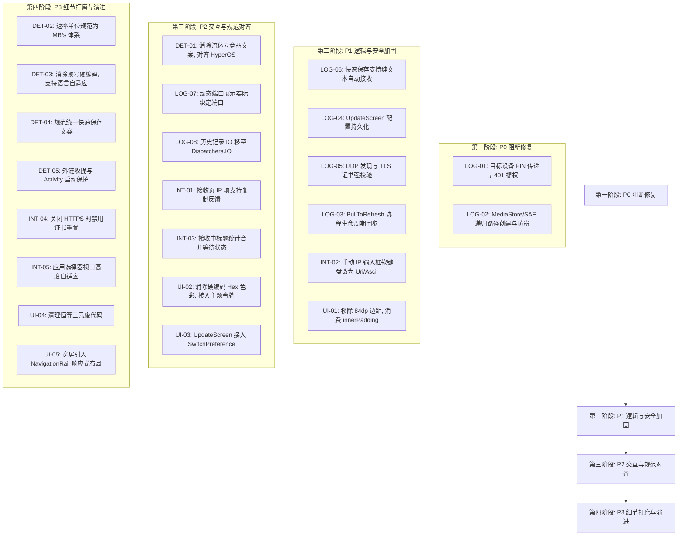

# LocalSend-Miuix 质量评估报告

**项目基准**：Xiaomi HyperOS / Miuix 风格 LocalSend Android 客户端（Kotlin 2.0+ / Compose / Miuix KMP 0.9.4-rc01 / Ktor 2.3.12 / OkHttp 4.12.0；Min SDK 26，Target SDK 35/36）。

## 1. 缺陷矩阵总览

全量审计共识别 **23 项质量缺陷**，按维度与严重级分布如下：

| 评估维度 | P0 (阻断) | P1 (严重) | P2 (主要) | P3 (次要) | 合计 |
|---|:---:|:---:|:---:|:---:|:---:|
| **细节问题 (DET)** | 0 | 0 | 1 | 4 | **5** |
| **业务逻辑 (LOG)** | 2 | 4 | 2 | 0 | **8** |
| **交互体验 (INT)** | 0 | 1 | 2 | 2 | **5** |
| **UI 视觉规范 (UI)** | 0 | 1 | 2 | 2 | **5** |
| **总计** | **2** | **6** | **7** | **8** | **23** |

---

## 2. 缺陷清单与修复方案

### 2.1 细节问题 (DET)

| 编号 | 级别 | 位置 | 缺陷表现与根因 | 修复方案 |
|---|:---:|---|---|---|
| **DET-01** | P2 | `strings.xml:118, 328` `LiveUpdatesCompat.kt:17` `TransferNotifier.kt:22` | **术语竞品混淆**：通知与渠道文案使用了 ColorOS 专属名词“流体云 (Aqua Dynamics)”，违背 HyperOS 品牌规范。 | 统一将中文文案及注释修正为 HyperOS 规范名词“焦点通知”与 Android 16+ 原生名词“实时活动”。 |
| **DET-02** | P3 | `TransferModel.kt:100-146` `LiveUpdatesCompat.kt:180-186` | **速率单位不一**：传输卡片显示带空格全称（如 `2.5 MB/s`），通知胶囊使用手写简写（如 `2.5M/s`），低速未处理 `B/s`。 | 统一在 `TransferModel.kt` 封装 `formatSpeed(speedBytes, compact: Boolean)`，规范单位使用 `MB/s`、`KB/s`、`B/s`。 |
| **DET-03** | P3 | `HistoryScreen.kt:263` `SendScreen.kt:208` | **标点硬编码中文顿号**：历史记录文件名列表直接用 `"、"` 拼接，非中文语境下截断排版违和。 | 提取多语言列表分隔符资源，或在代码中根据系统语言动态选择（中文为 `、`，其他语言为 `, `）。 |
| **DET-04** | P3 | `strings.xml:69, 122` | **配置项措辞不一致**：“快速保存”开关在主页文案动词为“接受”，在全局设置页动词为“接收”。 | 统一两处文案定义，动词标准化为“接收”。 |
| **DET-05** | P3 | `SettingsScreen.kt:242-262` | **链接硬编码与空异常捕获**：GitHub 地址字面量硬编码于 UI；空 `catch` 导致无浏览器设备上点击无反馈。 | 链接抽取至 `Constants.kt`；捕获 `ActivityNotFoundException` 时弹出 Toast 友好提示。 |

---

### 2.2 逻辑问题 (LOG)

#### LOG-01 [P0] 目标设备开启 PIN 时发送必现失败
- **位置**：`LocalSendClient.kt:71-73`、`LocalSendManager.kt:208`
- **根因**：发送端握手 `PREPARE_UPLOAD` 时，携带的是本机接收设置的 PIN 码而非目标设备的验证 PIN。目标设备启用 PIN 时必然返回 HTTP 401，且客户端未处理 401 提权流程，传输直接中断。
- **修复**：`prepareUpload` 增加 `targetPin: String? = null` 参数；捕获 HTTP 401 后在 UI 弹出目标 PIN 输入框并支持带 PIN 重试。

#### LOG-02 [P0] 跨端文件夹传输在 MediaStore 与 SAF 下崩溃或层级丢失
- **位置**：`LocalSendServer.kt:125-153`、`LocalSendManager.kt:835-847`
- **根因**：
  1. **MediaStore**：`DISPLAY_NAME` 写入含斜杠的相对路径（如 `a/b.txt`），触发 Android 10+ 抛出 `IllegalArgumentException` 崩溃，且子目录层级丢失。
  2. **SAF**：`DocumentFile.createFile` 无法递归解析多级路径，导致子目录创建失败。
- **修复**：拆分相对路径与叶子文件名；MediaStore 写入 `RELATIVE_PATH = ".../LocalSend/" + subDir` 且 `DISPLAY_NAME` 仅填叶子名；SAF 模式递归查找并创建中间目录。

#### LOG-03 [P1] 下拉刷新状态同步复位破坏指示器动画
- **位置**：`SendScreen.kt:154-159`
- **根因**：`onRefresh` 触发异步扫描协程后，同步在同一帧将 `isRefreshing` 置为 `false`，导致刷新指示器未展示转圈动画即瞬间缩回。
- **修复**：将 `isRefreshing` 状态与 `manager.isScanning` 响应式绑定，或在协程扫描结束后再置为 `false`。

#### LOG-04 [P1] 更新设置项全部为内存临时变量未持久化
- **位置**：`UpdateScreen.kt:89-92`
- **根因**：“自动检查更新”、“忽略此版本”、“HyperOS 3 流光特效”均使用本地 `remember { mutableStateOf(...) }`，离开页面或应用重启后配置全部丢失。
- **修复**：在 `Settings.kt` 增加对应字段，统一收拢至 `SharedPreferences` 进行磁盘持久化。

#### LOG-05 [P1] UDP 多播发现阶段缺乏证书指纹比对存在伪造信任风险
- **位置**：`DiscoveryService.kt:152-155`、`CertificateBinding.kt`
- **根因**：监听到多播报文后直接将声明的 `fingerprint` 写入 `FingerprintTrust`，未核验真实 TLS 证书。
- **修复**：UDP 发现仅缓存设备信息；仅在真实 TLS 握手时通过 `CertificateBinding.dtoMatchesCert` 核验对端证书与声明一致后再加入信任列表。

#### LOG-06 [P1] 快速保存逻辑反向过滤纯文本导致文本传输强弹窗
- **位置**：`LocalSendServer.kt:1351-1356`
- **根因**：自动接收判定条件为 `isQuickSave() && !isTextSession`，纯文本传输被显式排除，强制走人工确认弹窗，后台或锁屏时导致会话挂起超时。
- **修复**：移除 `!isTextSession` 过滤，开启快速保存时所有内容均自动接收；文本接收后由 `settings.autoCopyText` 控制是否写入剪贴板。

#### LOG-07 [P2] 端口冲突回退后 UI 展示脱节
- **位置**：`LocalSendServer.kt:285-293`、`ReceiveScreen.kt:119`
- **根因**：默认 53317 端口占用后服务器已回退绑定至候选端口（如 53318），但接收页依然展示 `settings.port` 配置值，导致对端手动连接失败。
- **修复**：UI 绑定改为展示实际监听端口（`manager.getLocalDevice().port`）。

#### LOG-08 [P2] 历史记录单例构造在主线程执行同步磁盘 IO
- **位置**：`LocalSendManager.kt:148`、`HistoryStore.kt:19-27`
- **根因**：`_transferHistory` 初始值在主线程通过 `historyStore.load()` 同步读取文件与反序列化，记录增多时存在启动卡顿与 StrictMode 违规风险。
- **修复**：初始赋予 `emptyList()`，在启动协程中通过 `Dispatchers.IO` 异步加载并回填。

---

### 2.3 交互问题 (INT)

| 编号 | 级别 | 位置 | 缺陷表现与根因 | 修复方案 |
|---|:---:|---|---|---|
| **INT-01** | P2 | `ReceiveScreen.kt:118-122` | **只读信息行使用箭头**：本机 IP/端口卡片使用 `ArrowPreference(onClick = {})`，暗示可跳转但点击无响应。 | 点击事件绑定“复制 IP:端口到剪贴板并提示”，或改用无箭头的 `BasicComponent`。 |
| **INT-02** | P1 | `Dialogs.kt:194` | **手动输入 IP 键盘缺失点号**：输入框配置 `KeyboardType.Number`，在部分定制输入法中呼出纯数字九宫格无点号 `.`，无法输入 IPv4。 | 将键盘类型调整为 `KeyboardType.Uri` 或 `KeyboardType.Ascii`。 |
| **INT-03** | P2 | `ReceiveScreen.kt:154` | **接收中标题计数与列表脱节**：分组标题统计仅计算 `InProgress`，待确认状态（`WaitingApproval`）下卡片已展示但标题计数为 0。 | 统计条件合并 `status == InProgress || status == WaitingApproval`。 |
| **INT-04** | P3 | `SettingsScreen.kt:222-226` `Dialogs.kt:460-469` | **未启用 HTTPS 时暴露无效重置**：关闭 HTTPS 时指纹行仍可点击，且弹窗提供危险的“重新生成”操作。 | 当 `!useHttps` 时将指纹项置灰（`enabled = false`），或点击时引导先开启 HTTPS。 |
| **INT-05** | P3 | `AppPickerBottomSheet.kt:248-273` | **应用选择器高度写死**：列表高度写死 `380.dp`，大屏/横屏无法有效利用空间；筛选状态下全选缺乏维度提示。 | 高度按屏幕高度百分比动态计算；搜索状态下全选按钮文案明确为“全选当前筛选 (%d 项)”。 |

---

### 2.4 UI 与视觉规范问题 (UI)

| 编号 | 级别 | 位置 | 缺陷表现与根因 | 修复方案 |
|---|:---:|---|---|---|
| **UI-01** | P1 | `App.kt:285, 355` | **底栏边距硬编码魔法数值**：手写 `84.dp + navBarBottomPadding` 绕过 Scaffold，破坏多端与横竖屏适配。 | 移除魔法值，页面统一消费 `innerPadding.calculateBottomPadding()`。 |
| **UI-02** | P2 | `TransferSessionCard.kt:570` `HistoryScreen.kt:302` | **色彩直接硬编码 Hex**：状态与按钮使用固定色（`0x16A34A`、`0xDC2626`、`White`），脱离 Miuix 动态取色与暗色模式。 | 失败态接入 `colorScheme.error`，按钮前景改用 `onPrimary` / `onError`，其余统一收拢至语义颜色体系。 |
| **UI-03** | P2 | `UpdateScreen.kt:400-430` | **偏离 Preference 规范**：使用 `BasicComponent + Switch` 手拼开关行，缺失整行可点、统一行高及触感反馈。 | 替换为官方 `top.yukonga.miuix.kmp.preference.SwitchPreference`。 |
| **UI-04** | P3 | `HistoryScreen.kt:229` | **三元表达式恒等死代码**：`tint = if (item.isTextMessage) primary else primary` 分支完全一致。 | 简化为 `tint = MiuixTheme.colorScheme.primary`。 |
| **UI-05** | P3 | `App.kt:320-341` | **缺乏大屏响应式布局**：平板与横屏模式（宽度 ≥ 600 dp）下底栏挤占纵向空间且横向大面积留白。 | 在宽屏断点下将底部导航自适应切换为侧边栏（`NavigationRail`）。 |

---

## 3. 整改实施路线图

